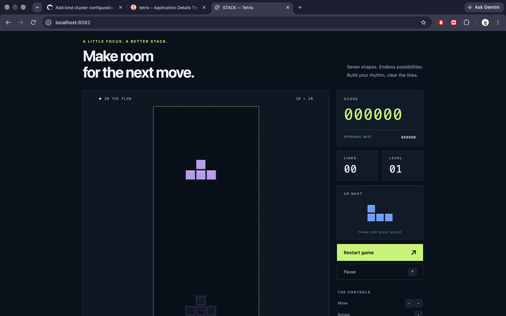
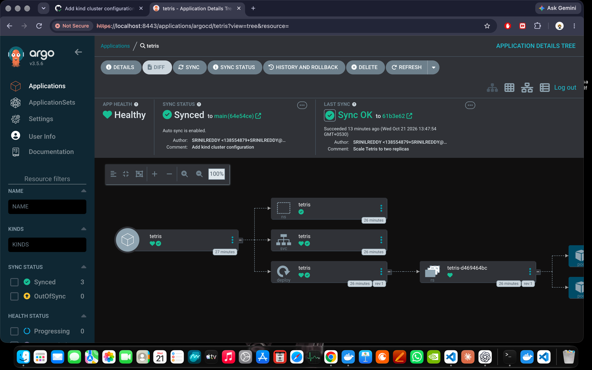
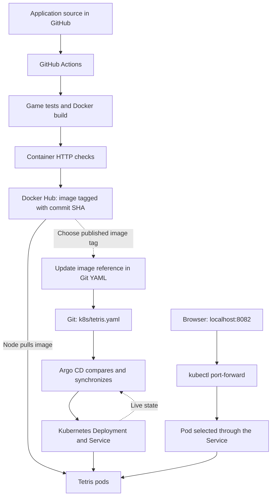

# STACK — Tetris with Docker, Kubernetes and Argo CD

A browser-based Tetris game with automated tests and container publishing through
GitHub Actions, deployed to a local kind cluster through Argo CD. The project
demonstrates Git-driven configuration changes, automatic sync and self-healing.

## Application preview

Tetris running at `localhost:8082` after deployment through Argo CD:



## Argo CD deployment

The dashboard shows **Healthy**, **Synced**, and **Auto sync is enabled**. Its
resource tree includes the namespace, Service, Deployment, ReplicaSet and pods.



Screenshots were captured from the local lab on October 21, 2026. The dashboard
version shown is Argo CD v3.5.6.

## Implemented and verified

- Containerized the static game with Nginx, running as the `nginx` user on port 8080.
- Added ten automated game-rule tests using Node.js's built-in test runner.
- Built and tested the container in GitHub Actions before publishing to Docker Hub.
- Deployed the application to kind with two replicas, resource requests/limits,
  readiness and liveness probes, and a ClusterIP Service.
- Installed Argo CD and connected it to the repository's `k8s` directory.
- Verified manual synchronization by changing replicas from two to three in Git.
- Verified automatic synchronization by changing replicas from three back to two in Git.
- Verified self-healing: a manual scale to one replica was corrected back to Git's two.
- Opened and started the game through Kubernetes port-forwarding.

## Architecture



GitHub Actions handles testing, image building and publishing. Argo CD handles
deployment configuration from Git. **Image-tag updates in the Git manifest are
currently manual:** publishing an image alone does not deploy that new version.

## Technology

| Component | Technology |
| --- | --- |
| Game | HTML, CSS and JavaScript |
| Web server | Nginx |
| Container | Docker |
| Tests | Node.js built-in test runner |
| CI | GitHub Actions |
| Image registry | Docker Hub |
| Kubernetes lab | kind |
| GitOps deployment | Argo CD |

The game executes in the browser. There is no backend API or database; personal
best scores use browser local storage. Node.js runs tests and is not part of
the production container. This application does not require a PVC.

## Project structure

```text
.
├── .dockerignore
├── .github/workflows/ci.yml
├── .gitignore
├── CI-SETUP.md
├── Dockerfile
├── README.md
├── app.js
├── docs/screenshots/
│   ├── argocd-status.png
│   └── tetris-game.png
├── engine.js
├── index.html
├── k8s/tetris.yaml
├── kind.yaml
├── nginx.conf
├── package.json
├── styles.css
└── tests/engine.test.js
```

`kind.yaml` configures cluster creation. It stays outside `k8s/` because Argo CD
reads that directory for application manifests.

## Prerequisites

- Git, Docker, kubectl and kind.
- Docker Desktop or another compatible Docker Engine setup running.
- Node.js 24 or newer for local tests.
- A Docker Hub account and access token for publishing through your own CI setup.

The current CI builds **linux/arm64** images to match the Apple Silicon lab.
Use compatible ARM64 nodes. AMD64 deployment requires an appropriate image
build; multi-platform publishing has not been implemented.

## Get the source and test

```bash
git clone https://github.com/SRINILREDDY/tetris-project.git
cd tetris-project
npm test
```

There are no npm dependencies to install. The tests cover game startup, piece
generation, collisions, rotation, hard drop, row clearing, scoring, level
progression, game over, pause and restart.

## Run locally with Docker

```bash
docker build -t tetris-app:v1 .
docker run -d --name tetris-game -p 127.0.0.1:8080:8080 tetris-app:v1
curl --fail http://localhost:8080/healthz
```

Open [http://localhost:8080](http://localhost:8080). The health endpoint returns
`ok`. To inspect or remove the local container:

```bash
docker logs tetris-game
docker rm -f tetris-game
```

## GitHub Actions pipeline

The workflow runs for pushes to `main`, pull requests targeting `main`, and
manual dispatches. It checks out the source, sets up Node.js, runs the game
tests, builds the ARM64 image, and checks `/healthz`, the HTML page and its assets.

After successful checks on `main`, it logs in to Docker Hub and pushes the same
tested image as `srinilreddy/tetris-app:<full-Git-commit-SHA>`. Pull requests run
checks without publishing. The workflow does not overwrite `v1` or `latest`.

Set these **repository secrets** in GitHub Settings -> Secrets and variables -> Actions:

| Secret | Value |
| --- | --- |
| `DOCKERHUB_USERNAME` | Docker Hub username; this project uses `srinilreddy` |
| `DOCKERHUB_TOKEN` | Actual Docker Hub personal access token with Read & Write permissions |

Credentials belong in secrets, not source files. A local Docker login does not
provide credentials to a GitHub-hosted runner.

## Create the kind cluster

The current lab uses cluster `tetris-lab` and context `kind-tetris-lab`.
If it does not already exist, create it from the repository configuration:

```bash
kind create cluster --name tetris-lab --config kind.yaml --wait 120s
kubectl --context kind-tetris-lab get nodes
```

The configuration creates one control-plane node. Application access uses
port-forwarding, so no NodePort or extra host-port mapping is required.

## Install and access Argo CD

Install the official manifests in the `argocd` namespace:

```bash
kubectl --context kind-tetris-lab create namespace argocd
kubectl --context kind-tetris-lab apply --server-side -n argocd \
  -f https://raw.githubusercontent.com/argoproj/argo-cd/stable/manifests/install.yaml
kubectl --context kind-tetris-lab wait --for=condition=Ready pod --all -n argocd --timeout=300s
```

The lab used the stable installation manifest. That branch can change over time;
the screenshots record the version used for the demonstrated deployment.

Run this in a separate terminal and keep it open:

```bash
kubectl --context kind-tetris-lab port-forward svc/argocd-server -n argocd 8443:443
```

Open [https://localhost:8443](https://localhost:8443). The default local installation
uses a self-signed certificate, which can cause a browser certificate warning.

Retrieve the initial password locally and log in as `admin`:

```bash
kubectl --context kind-tetris-lab get secret argocd-initial-admin-secret \
  -n argocd -o jsonpath='{.data.password}' | base64 --decode
```

Keep the password private. For account maintenance, change the initial admin
password and remove the initial-password Secret afterward.

## Connect the repository and deploy

Create a new Application in the Argo CD dashboard:

| Field | Value |
| --- | --- |
| Application name | `tetris` |
| Project | `default` |
| Repository URL | `https://github.com/SRINILREDDY/tetris-project.git` |
| Revision | `main` |
| Path | `k8s` |
| Destination cluster | `https://kubernetes.default.svc` (`in-cluster`) |
| Destination namespace | `tetris` |
| Initial sync policy | Manual, for the first deployment exercise |

Click **Create**, then **Sync -> Synchronize**. The namespace is included in
`k8s/tetris.yaml`. The manifest also defines two replicas, CPU/memory requests
and limits, `/healthz` readiness/liveness probes, and a ClusterIP Service
forwarding port 80 to container port 8080.

The Application was created through the UI; its configuration is not yet stored
as an Application manifest in this repository. Repeat this setup after creating
a fresh cluster, or add an Application manifest outside `k8s/` as a future improvement.

After the first sync, enable automatic sync and self-healing:

```bash
kubectl --context kind-tetris-lab patch application tetris -n argocd --type merge \
  -p '{"spec":{"syncPolicy":{"automated":{"enabled":true,"selfHeal":true}}}}'
```

Verify the application and workload:

```bash
kubectl --context kind-tetris-lab get application tetris -n argocd
kubectl --context kind-tetris-lab get pods,svc -n tetris
```

## Open the game

In another terminal, keep this command running:

```bash
kubectl --context kind-tetris-lab port-forward svc/tetris -n tetris 8082:80
```

Open [http://localhost:8082](http://localhost:8082). This is the address shown in
the application screenshot. Dashboard access uses HTTPS port 8443; the local
Docker example uses HTTP port 8080. Closing port-forwarding stops local browser
access but does not stop the pods or Argo CD synchronization.

Click **Start game** and focus the board. Use left/right arrows to move, up to
rotate, down to soft drop, Space to hard drop, and P/Escape to pause or resume.

## Verified GitOps exercises

| Exercise | Change | Observed result |
| --- | --- | --- |
| Manual sync | Git replicas: 2 -> 3, followed by a manual sync | Three Ready pods |
| Automatic sync | Git replicas: 3 -> 2, with automatic sync enabled | Returned to two pods without clicking Sync |
| Self-healing | Live Deployment scaled to 1; Git remained at 2 | Argo CD restored 2/2 Ready |

To repeat the self-healing exercise while Git still specifies two replicas:

```bash
kubectl --context kind-tetris-lab scale deployment/tetris -n tetris --replicas=1
kubectl --context kind-tetris-lab get deployment tetris -n tetris -w
```

Wait for Argo CD to restore two replicas, then press Ctrl+C. Scaling the live
Deployment creates configuration drift; leaving the Git YAML unchanged makes
the correction observable. Simply deleting a pod would instead demonstrate
Kubernetes' own pod replacement behavior.

For a new application image, first wait for CI to publish its commit-SHA tag.
Update the image reference in `k8s/tetris.yaml`, commit and push it. Argo CD then
synchronizes that configuration. CI does not currently edit this reference.

## Troubleshooting

```bash
kubectl --context kind-tetris-lab describe pods -n tetris
kubectl --context kind-tetris-lab logs deployment/tetris -n tetris --tail=50
kubectl --context kind-tetris-lab get events -n tetris --sort-by=.metadata.creationTimestamp
kubectl --context kind-tetris-lab get pods -n argocd
```

- **ImagePullBackOff:** check the published tag, node architecture, network and
  registry access. Private images require pull credentials in the cluster.
- **OutOfSync:** compare the Git and live manifests, check sync policy and review
  the application conditions. Refresh discovers changes; Sync applies them.
- **Browser cannot connect:** verify the appropriate port-forward is running.
- **HTTP works but gameplay fails:** inspect browser console errors and JavaScript assets.

## Current scope and future improvements

This is a local learning and portfolio project. Automated game and HTTP tests
do not replace browser interaction tests or a security review.

- Vulnerability scanning is currently removed from CI. Earlier findings have
  not been demonstrated as fixed; a green workflow is not a clean scan result.
- Image-version updates in Git remain manual.
- The image pipeline currently publishes ARM64 only.
- Store the Argo CD Application definition in Git for reproducible setup.
- Review vulnerability findings and restore scanning.
- Extend the project to ECR/EKS and provision AWS infrastructure with Terraform.

## References

- [Argo CD getting started](https://argo-cd.readthedocs.io/en/stable/getting_started/)
- [Automatic sync and self-healing](https://argo-cd.readthedocs.io/en/stable/user-guide/auto_sync/)
- [kind configuration](https://kind.sigs.k8s.io/docs/user/configuration/)
